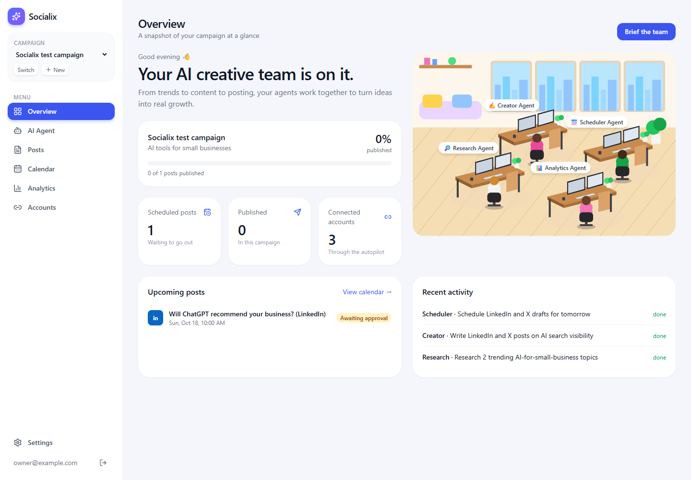
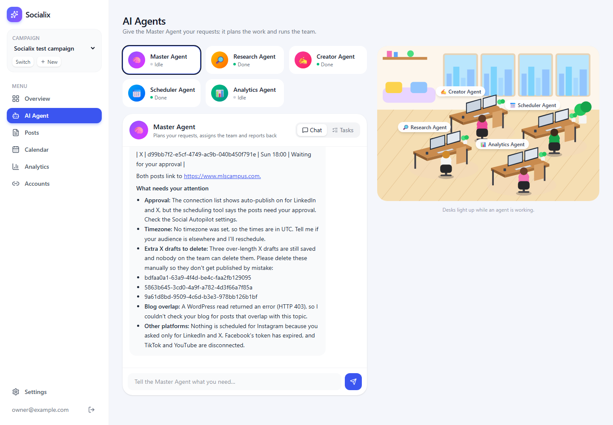
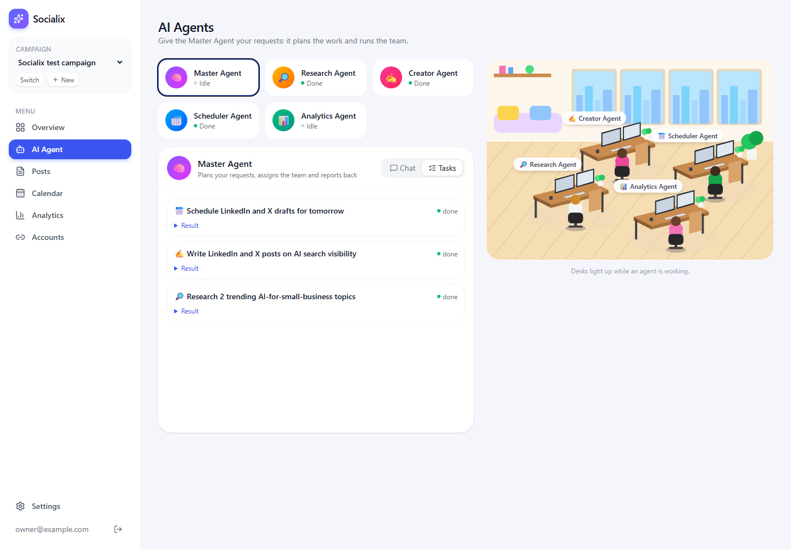
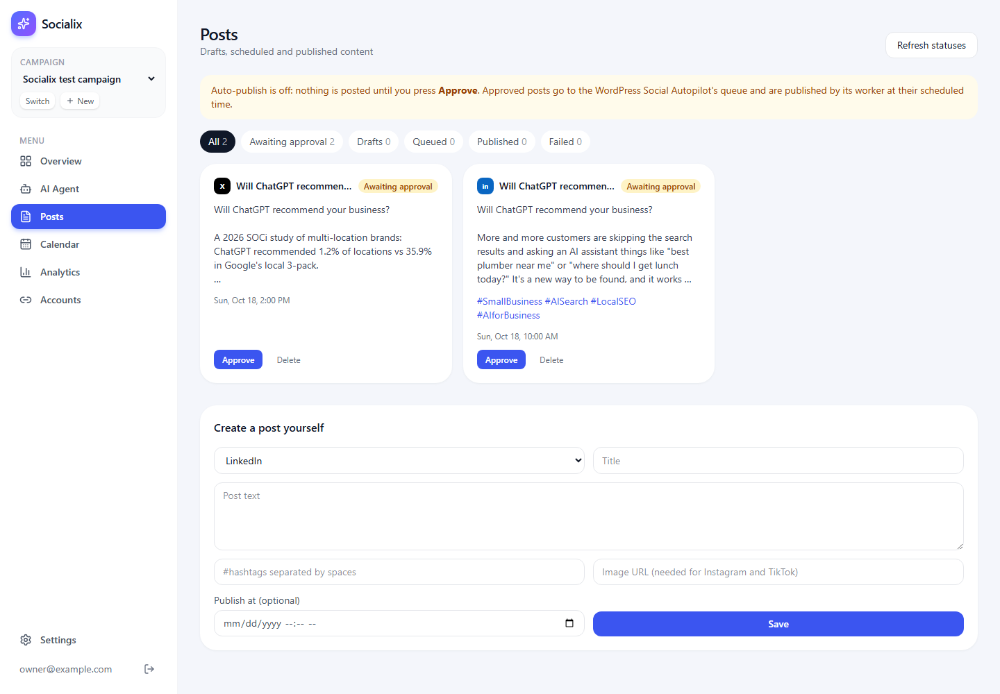
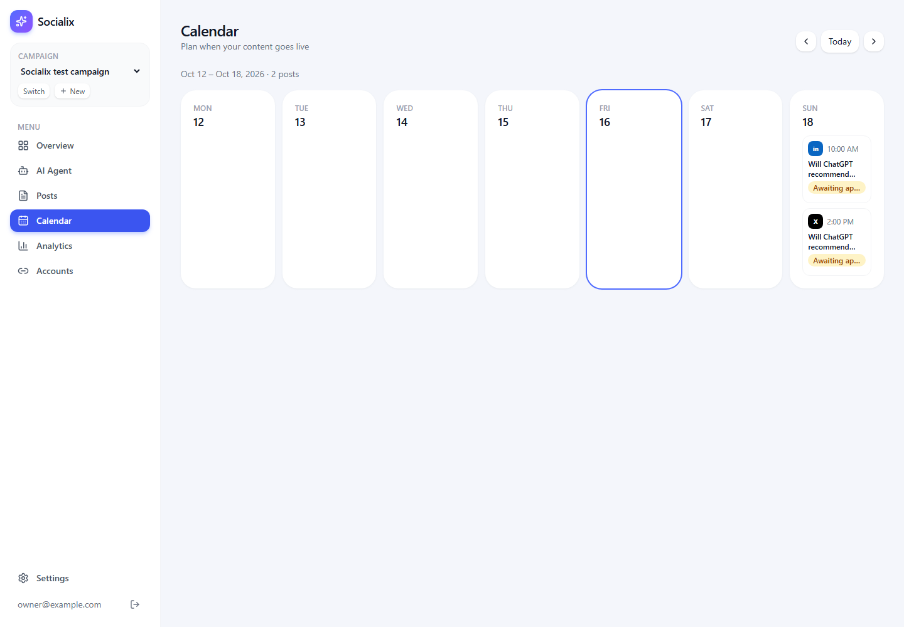
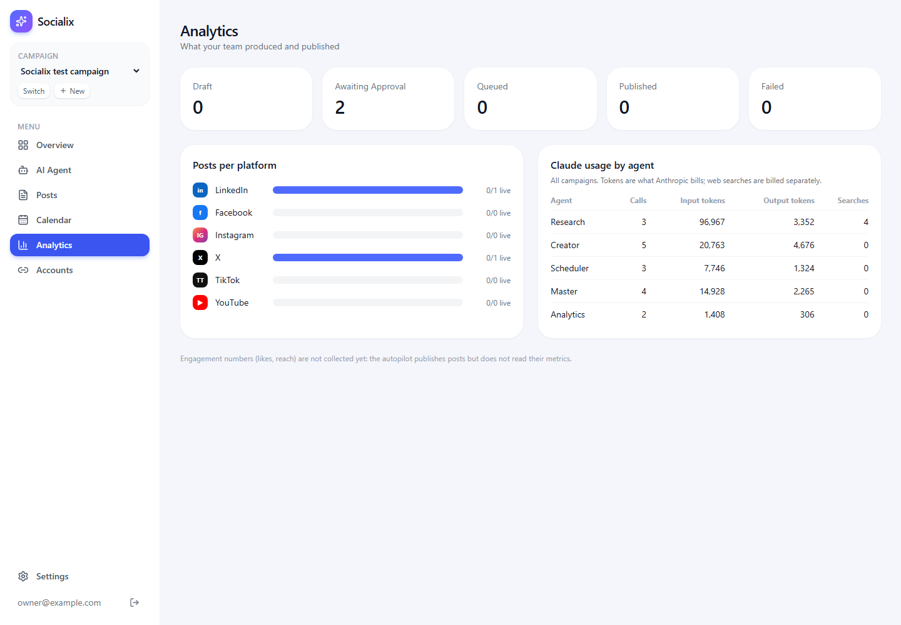
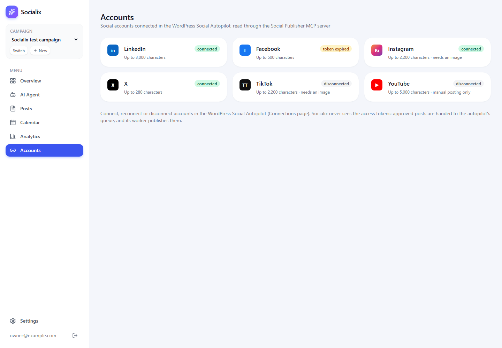
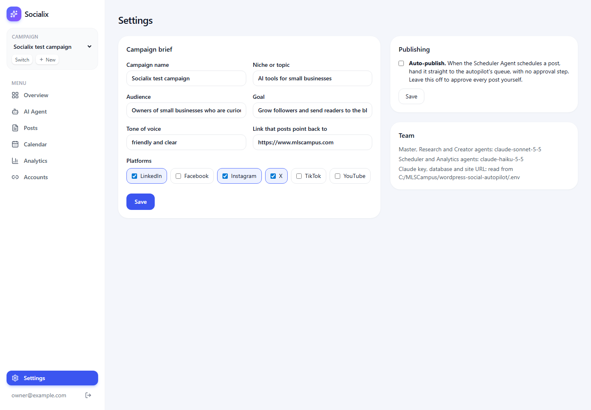

# 3. User guide

## The everyday workflow

1. **Create a campaign** (once per brand or topic).
2. **Brief the Master Agent** on the AI Agent page, in plain words.
3. **Watch the team work.** Research finds facts, Creator writes the posts, Scheduler picks times.
4. **Review the posts** on the Posts page and press **Approve** on the ones you like.
5. **Keep the autopilot worker running.** It publishes each approved post at its time.
6. **Check the results** on the Posts, Calendar and Analytics pages.

---

## Step 1: Sign in

Open http://localhost:3100. Enter the email and password from this project's `.env` file
(`APP_LOGIN_EMAIL` and `APP_LOGIN_PASSWORD`). The first time, you are taken straight to
**Create campaign**.

## Step 2: Create a campaign

A campaign is the brief every agent reads before it works. Fill in:

| Field | Example | Why it matters |
|---|---|---|
| Campaign name | Spring launch | Shown in the campaign picker |
| Niche or topic | Home fitness for busy parents | What the Research Agent searches for |
| Audience | Parents aged 30-45 in the US | Shapes the wording and the posting times |
| Goal | Grow followers and drive visits to the blog | What the posts try to achieve |
| Tone of voice | friendly and clear | How the Creator writes |
| Link that posts point back to | https://your-site.com | Added at the end of every post |
| Platforms | LinkedIn, Instagram, X | Which networks the team writes for |

Press **Create campaign**. You can change all of this later in **Settings**.

To work on several brands, press **+ New** in the sidebar. Use the campaign picker and **Switch** to
move between them. Each campaign has its own posts, research, chats and tasks.

## Step 3: Brief the team (AI Agent page)

The five agent cards are at the top. Click one to talk to it; the **Master Agent** is selected by
default. Type your request in the box at the bottom and press **Send** (or Enter).

Good requests say *what*, *how many*, *which platforms* and *when*. Examples:

- "Research 2 trending topics about AI tools for small businesses this week, then write one LinkedIn
  post and one X post about the best one, and schedule them for tomorrow at good times."
- "Write 3 LinkedIn posts for next week about our spring offer, spaced out, at 9 am New York time."
- "Give me a status report on this campaign's posts."

What happens next:

- The Master Agent splits the request into tasks and hands each to a team member, in order.
- The desks in the **office picture** light up while an agent works, and each card shows *Working*,
  *Done* or *Idle*.
- The **Tasks** tab lists every task. Click **Result** to read what that agent reported.
- When everything is done, the Master Agent replies in the chat with a summary.

A full research-write-schedule request takes a few minutes. You can leave the page; the work
continues and the results are there when you come back.

### Talking to one agent directly

Click any agent card to chat with that agent alone:

| Agent | Ask it to... |
|---|---|
| Master | Plan and run a whole request across the team |
| Research | "Find this week's news about X and save the 3 most useful findings" |
| Creator | "Write an Instagram caption about our new product using the saved research" |
| Scheduler | "Schedule all drafts for next Tuesday and Thursday mornings" |
| Analytics | "What was published, what failed, and what should I do next?" |

The Creator checks each platform's character limit, counting the hashtags and the campaign link
(X 280, Facebook 500, LinkedIn 3000, Instagram and TikTok 2200). It will not save a post that is too
long.

## Step 4: Review and approve (Posts page)

The tabs filter posts by status: **All, Awaiting approval, Drafts, Queued, Published, Failed**.

| Status | Meaning | Buttons |
|---|---|---|
| Draft | Written, not scheduled yet | Approve & publish now, Delete |
| Awaiting approval | Has a time, waits for you | Approve, Delete |
| Queued | Approved and in the autopilot's queue | Cancel |
| Published | Live on the network (with a link to it) | none |
| Failed | The network refused it; the reason is shown | Approve (to try again), Delete |
| Cancelled | You cancelled it before it went out | Delete |

- **Approve** sends the post to the autopilot's queue, and it is published at its scheduled time. If
  that time has already passed, or the post has no time, it is published as soon as the worker sees it.
- **Cancel** removes a queued post from the queue before it is published.
- **Delete** removes a post from Socialix. Queued posts must be cancelled first.
- **Refresh statuses** asks the autopilot what happened to queued posts (published or failed). The
  Analytics Agent also does this.

> **Approving publishes for real.** The post goes public on your account once the worker runs.

### Writing a post yourself

Use **Create a post yourself** at the bottom of the Posts page. Pick the platform and write the
title, the text and the hashtags (separated by spaces). Add an image URL for Instagram or TikTok, and
optionally a date and time. With a time, the post waits for approval; without one, it is saved as a
draft.

## Step 5: Calendar

A week view of every scheduled post. Use the arrows to change week and **Today** to come back.
Times are shown in this computer's time zone.

## Step 6: Analytics

- Counts of posts by status, and posts per platform (how many are live).
- **Claude usage by agent:** calls, input and output tokens, and web searches. This is what the
  Anthropic API bills you for, so check it now and then.

Likes, reach and other engagement numbers are **not** collected yet.

## Accounts

Shows each network's status in the autopilot (connected, token expired, disconnected), its character
limit, and whether it needs an image. You cannot connect accounts here: do it on the autopilot's
**Connections** page (http://localhost:3000 when the autopilot dashboard runs). The Scheduler Agent
never schedules to a network that is not connected.

| Network | Notes |
|---|---|
| LinkedIn, X, Facebook | Text posts work |
| Instagram, TikTok | Need a public image URL (Socialix does not create images) |
| YouTube | Not supported for automatic posting |

## Settings

- **Campaign brief:** edit everything you entered when creating the campaign, then press **Save**.
- **Auto-publish:** when ticked, posts the Scheduler schedules go straight to the queue with no
  approval step. Leave it off until you trust the team's posts.
- **Team:** which Claude model each agent uses and where the keys are read from.

## Signing out

Click the arrow icon next to your email at the bottom of the sidebar.
